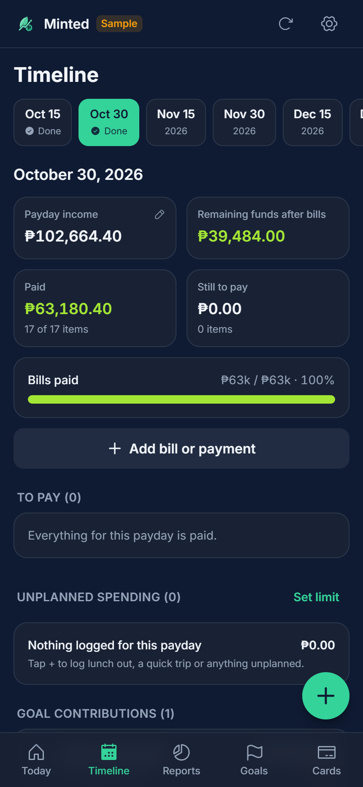
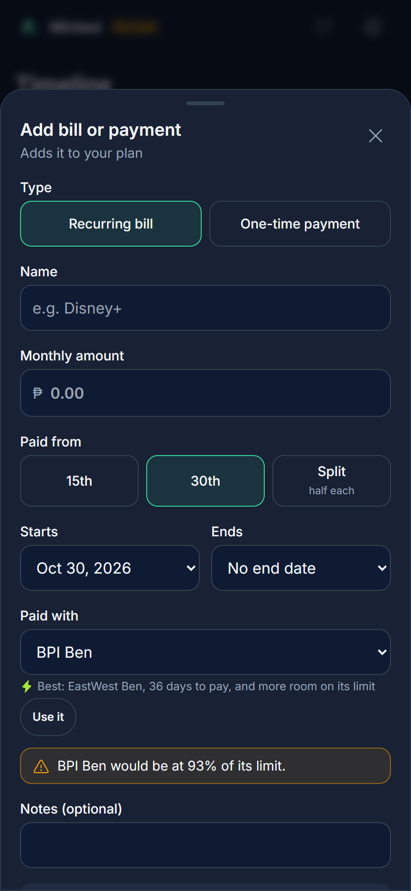
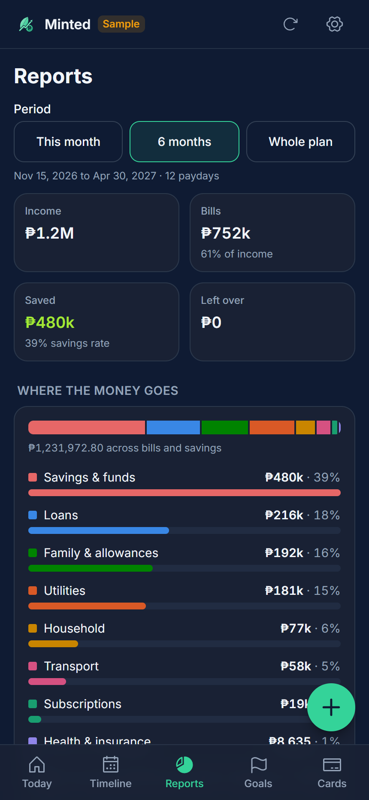
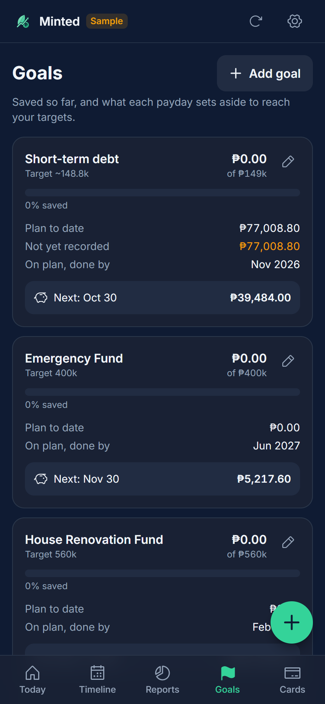
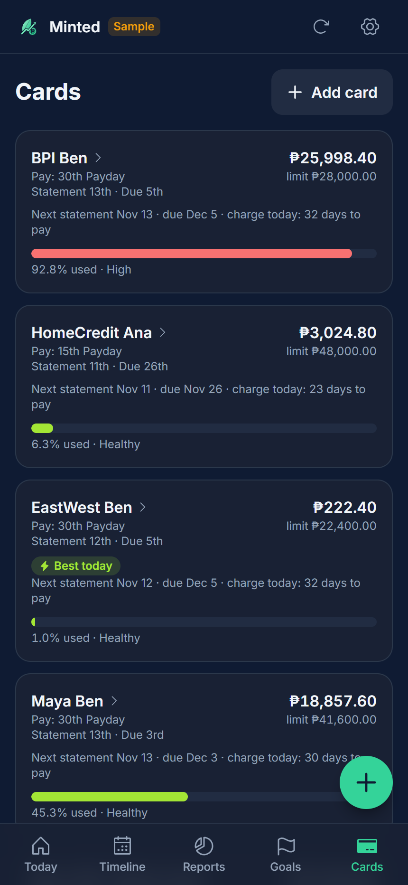

# Minted

Minted is a phone-first budget app for a household that plans its money in a Google Sheet. It reads the sheet, shows what's due on each payday (the 15th and the 30th), and writes back what you pay. The sheet stays the source of truth, so you can keep editing it by hand and both phones see the same numbers.

It runs as a web app on GitHub Pages. On Android, open it in Chrome and choose *Add to Home screen* to install it.

<p>
  
  
  
  
  
</p>

The screenshots use the made-up sample household that ships with the repo.

## What it does

Each payday shows its income, what's paid, what's still to pay, and the remaining funds after bills. Tap a bill to mark it paid at the amount you actually paid, or open it to change the amount, schedule, card, category, notes or end date. You can add recurring bills and one-time payments, and extend the plan six months at a time.

The **+** button logs unplanned spending such as lunch out or a quick trip. Each payday's total goes into one "Unplanned spending" row, so the sheet's totals stay right, and you can set a limit per payday. Spending can also come out of a sinking fund instead.

Cards have a statement day and a due day. Minted uses them to suggest which card gives the most days to pay, flag bills charged just before a statement closes, and remind you to pay each card on the payday before it's due. You can pay part of a card early, from money already budgeted, from extra funds, or as a contribution to a goal such as paying down debt. Deleting a card walks you through moving its bills first.

Goals and sinking funds show what's saved, the target, and when the plan reaches it. Funds also keep a record of withdrawals. Income can be changed per earner from any payday, with one-time extras like a 13th-month bonus.

Reports cover this month, the next six months or the whole plan: where the money goes by category, the largest payments, income against spending by month, spending by card, when each loan ends and what it frees up, and bills paid over or under plan. Categories are guessed from bill names, and you can change any of them.

## How it reads the sheet

Minted finds rows by their labels, not by row number, so you can add or reorder bills in the sheet.

| Where | What Minted uses it for |
| --- | --- |
| Rolling Execution Plan, header row | `Category · Description · Notes · Payment Method · Monthly Budget · 15th Payday · 30th Payday · <payday dates>` |
| Category `15th Payday`, `30th Payday`, `Equal Split` | Bills |
| Category `New Goal` | Sinking funds |
| Category `Income`, `Summary` | Payday income, total expenses and surplus, from your formulas |
| Category `Goals` | Goal contributions per payday |
| `Card Name` table below the bills | Card limits, utilization, and the Statement Day and Due Day columns |
| Sheet2 `Financial Goal` rows | Goal targets ("Target 500k") and the planned amount per payday |

A bill counts as paid when its payday cell has a note starting with `Paid` (Minted writes `Paid 2026-11-03 by Ana`). It also counts as paid when the payday has arrived and the cell no longer matches the planned amount, because that means someone typed in the actual amount. A ₱0 cell means the bill isn't due that payday.

Minted never inserts columns into the ledger. The payday formulas use `MOD(COLUMN(), 2)` to tell the 15th from the 30th, so a new column would swap them. Extra details go into cell notes: a bill's category is a note on its name, and a card's notes are a note on the card name.

Some features add to the sheet the first time you use them:

- the **Spending Log**, **Card Payments** and **Fund Withdrawals** tabs;
- an **Unplanned spending** row and an **Extra card payments** row at the end of the Equal Split section;
- the **Statement Day** and **Due Day** headers in the card table.

## Setup

### 1. Use a native Google Sheet

Google's API can't write to an `.xlsx` file. Open the file in Google Drive and choose **File → Save as Google Sheets**, then share the new sheet with each household Google account as an **Editor**. The sheet ID is the part of its link between `/d/` and `/edit`. From then on, use the new sheet; the `.xlsx` stops updating.

### 2. Create a Google OAuth client

This is free and takes about five minutes.

1. In the [Google Cloud console](https://console.cloud.google.com/), create a project.
2. Under **APIs & Services → Library**, enable the **Google Sheets API**.
3. Under **OAuth consent screen**, choose *External*, fill in the app name and your email, and add each household Gmail under **Test users**. Leaving the app in *Testing* is fine for personal use.
4. Under **Credentials → Create credentials → OAuth client ID**, choose *Web application* and add these **Authorized JavaScript origins**:
   - `http://localhost:5173`
   - `https://<your-github-username>.github.io`
5. Copy the client ID (it ends in `apps.googleusercontent.com`). It isn't a secret.

Origins go under *Authorized JavaScript origins*, not *Authorized redirect URIs*. Without them, sign-in fails with `origin_mismatch`.

### 3. Run it locally

```bash
npm install
cp .env.example .env.local   # then fill in VITE_GOOGLE_CLIENT_ID and VITE_SHEET_ID
npm run dev                  # http://localhost:5173/minted/
npm test
```

In local development you can also choose **Try with sample data**; changes stay in that browser. Add `?today=2026-11-15` to the URL to see the app as it would look on another date.

`src/data/sample.json` is the made-up household behind the sample mode and the tests. It's only included in development builds, never in the GitHub Pages build. This repo is public, so never commit real household figures.

### 4. Deploy to GitHub Pages

1. Push this folder to the `main` branch of a GitHub repo.
2. In the repo, set **Settings → Pages → Source** to **GitHub Actions**.
3. Under **Settings → Secrets and variables → Actions → Variables**, add `VITE_GOOGLE_CLIENT_ID` and `VITE_SHEET_ID`.
4. Push again, or run the workflow by hand. The app is at `https://<user>.github.io/<repo>/`; the workflow takes the base path from the repo name.

Every push to `main` runs the tests, builds and redeploys. Installed copies pick up the new version the next time they open.

## Scripts

| Command | What it does |
| --- | --- |
| `npm run icons` | Renders `public/icon.svg` to the PNG app icons |
| `node scripts/screenshots.mjs` | Retakes the README screenshots from the dev server with headless Chrome (pass the browser path if it isn't the default Chrome location) |
| `node scripts/capture-fixture.mjs` | Turns a link-shared sheet into the sample-data format, for local experiments only |

To try the app on a copy of real data locally:

```bash
curl -sL "https://docs.google.com/spreadsheets/d/<id>/htmlview/sheet?headers=true&gid=<rolling gid>" -o rolling.html
curl -sL "https://docs.google.com/spreadsheets/d/<id>/htmlview/sheet?headers=true&gid=<sheet2 gid>" -o sheet2.html
node scripts/capture-fixture.mjs rolling.html sheet2.html > sample.real.json   # gitignored
```

This only works while the sheet is link-shared, and the tests expect the made-up figures, so leave `src/data/sample.json` as it is.

## Android app (later)

The same code can be wrapped as an Android app with Capacitor:

```bash
npm i @capacitor/core @capacitor/android && npm i -D @capacitor/cli
npx cap init "Minted" com.household.minted --web-dir dist
VITE_BASE=./ npm run build && npx cap add android && npx cap open android
```

Google's web sign-in popup doesn't run inside an Android WebView. The Android build needs a native sign-in plugin (for example `@capgo/capacitor-social-login`) and an Android OAuth client in the same Cloud project. Only `src/lib/backend/googleAuth.ts` has to change.
